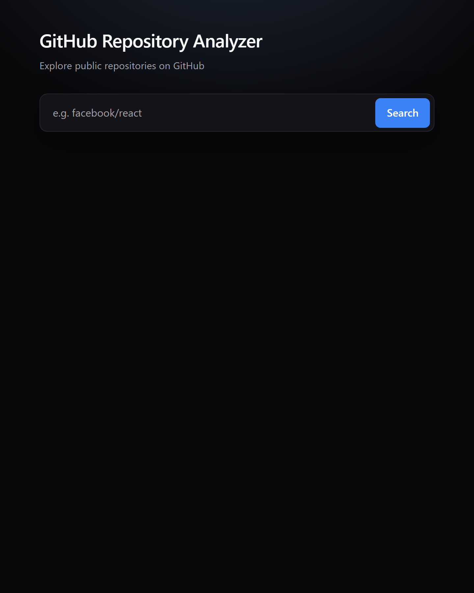
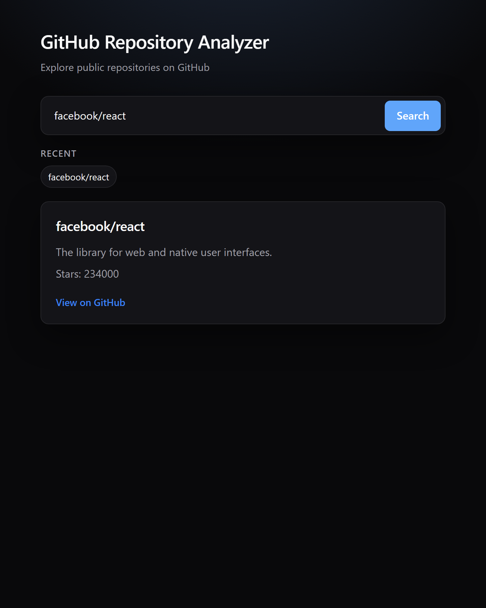

# GitHub Repository Analyzer

A small React app to search public GitHub repositories (`owner/repo`), see key metadata, and revisit recent searches. Built as a **learning project** for controlled inputs, effects, composition, custom hooks, and `localStorage`—with a dark, minimal UI.





## Features

- Search with `owner/repo` validation
- Loading, validation errors, and API errors
- Repository overview (name, description, stars, link)
- Recent searches (persisted in `localStorage`, click to search again)
- GitHub API with optional **mock mode** for offline development

## Tech stack

- [Vite](https://vitejs.dev/) + [React 19](https://react.dev/) + TypeScript
- GitHub REST API (`GET /repos/{owner}/{repo}`)
- CSS variables, component-scoped styles (no UI framework)

## Getting started

```bash
npm install
copy .env.example .env   # Windows — on macOS/Linux: cp .env.example .env
npm run dev
```

Real UI screenshots (optional, for maintainers):

```bash
npm run dev
npm run screenshots
```

Requires the dev server on `http://localhost:5173` (or set `SCREENSHOT_URL`).

Open the URL shown in the terminal (usually `http://localhost:5173`).

### Environment

| Variable | Description |
|----------|-------------|
| `VITE_USE_MOCK` | `true` → `mockData.ts`; `false` → live GitHub API |
| `VITE_GITHUB_TOKEN` | Optional; reduces rate-limit issues when using the real API |

## Scripts

| Command | Purpose |
|---------|---------|
| `npm run dev` | Development server |
| `npm run build` | Type-check + production build |
| `npm run preview` | Preview production build |
| `npm run lint` | ESLint |

## Project structure

```
src/
  api/          # fetch + mock switch
  components/   # UI (SearchBar, Overview, History, …)
  hooks/        # useRepository (fetch side-effects)
  styles/       # global tokens
  types/        # GitHub-related types
  utils/        # search history (localStorage)
```

## Concepts practiced

| Area | Implementation |
|------|----------------|
| State | `searchQuery` vs `submittedRepo`, `searchId` for re-search |
| Effects | `useRepository` + cleanup (`cancelled`) |
| Composition | Container (`App`) vs presentational components |
| Data | Callback props to lift repo + loading state |
| Persistence | `addSearchHistory` / `getSearchHistory` |

## License

MIT (learning / portfolio use).